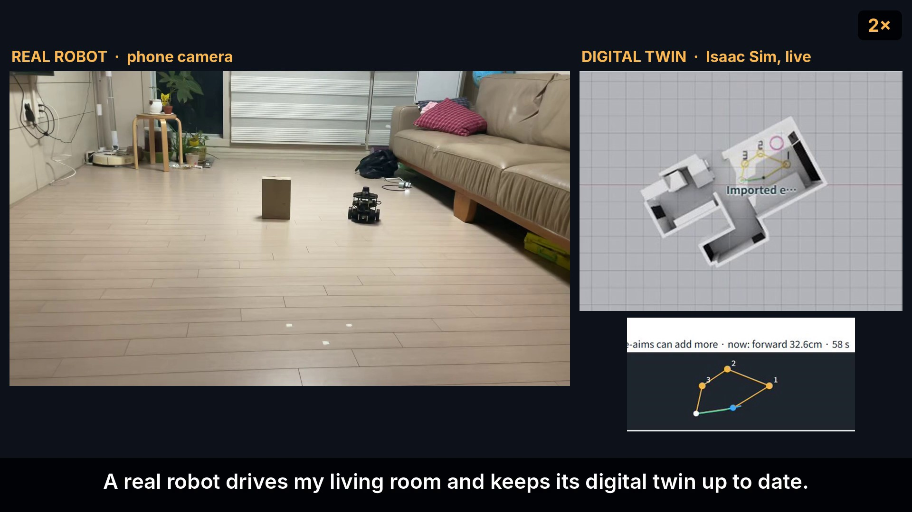
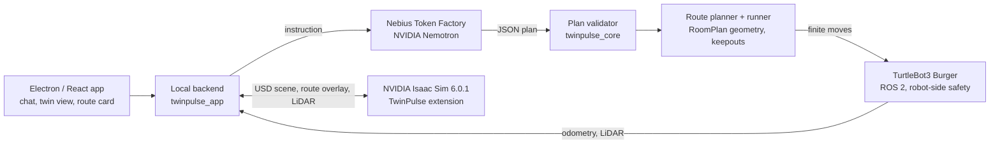

# TwinPulse

**Build a digital twin with far less manual modelling, then keep it in sync with the real site.** You describe what you want in plain English. NVIDIA Nemotron (served by Nebius Token Factory) turns it into a validated plan. A real TurtleBot3 drives that plan, and its LiDAR puts what the twin was missing back into the NVIDIA Isaac Sim USD scene.

[](LICENSE) · Nebius x NVIDIA Global AI Hackathon · **Physical AI track**

## Demo

▶ **[Watch the demo (YouTube, 2:55)](https://youtu.be/E4bx8Yp5gzg)**

[](https://youtu.be/E4bx8Yp5gzg)

## The problem

I was a Factory Automation Engineer. In Siemens Plant Simulation I built digital-twin environments **and** developed, simulated and evaluated AGV (automated guided vehicle) operating logic. Two problems kept coming back:

1. **Building a digital twin is hard and labor-intensive.** The initial build is a project of its own. Many engineers are assigned to model every machine, rack and aisle, and to code the operating logic.
2. **Keeping it current is just as hard, with far fewer people.** After the build, a small team maintains the twin while the site keeps changing: pallets left in aisles, objects moved, layouts evolving. There is no easy way to find what changed. Each change means editing 3D objects and logic (SimTalk) by hand, understanding the dependencies, and validating again, so the twin slowly drifts away from reality.

The core insight is firsthand, not speculative: **the cost is not only the first twin, but keeping the twin and its operating logic aligned with a changing physical world.**

Plant Simulation was the right tool at work. For this project, commercial license procurement, budget and approval overhead were a real reason to explore a more accessible stack built on NVIDIA Isaac Sim and open, extensible components.

## Who it is for

- **Primary:** industrial and factory automation engineers who build and maintain digital twins and AGV operation scenarios. This is the problem I lived.
- **Adjacent (hypotheses, not yet validated):** warehouses, hospitals, restaurants and other service-robot sites whose layouts change. These are customer-discovery questions, not claims.

## The idea

TwinPulse is not a text-to-3D generator: the product is the build-and-maintain loop. It is a product and workflow layer on top of Isaac Sim, not a new physics engine, and it works in SIM-only mode without a robot. It closes one loop:

```text
BUILD  →  OPERATE  →  OBSERVE  →  UPDATE  →  RE-SIMULATE
scan, photos,   robot drives    LiDAR + pose    changes go     re-plan on the
plain English   a planned task  vs. the twin    into the USD   updated twin
```

1. **Text and image environment updates** — create and edit the twin by describing changes, instead of rebuilding it by hand.
2. **Robot operation from plain English** — a model proposes the task; trusted code checks and executes it.
3. **LiDAR-assisted alignment** — the robot's sensor shows where the twin and reality disagree.
4. **Re-simulate and validate** — every change keeps review, approval, Undo and a recorded result.

Natural-language changes to plant-wide AGV dispatch logic are the founding goal. Today TwinPulse changes the environment and robot tasks; dispatch-logic editing is on the roadmap, not in this demo.

## What the demo shows

One loop, all inside the TwinPulse app:

1. **Build the twin.** Import an iPhone RoomPlan USD scan into Isaac Sim. NVIDIA Nemotron VL looks at a room photo and proposes objects the scan missed; accepted ones are placed next to the furniture they belong to.
2. **Place the robot** on the twin where it really stands (tape-measured), with its heading.
3. **Say what you want:** "Survey the room and come back." Nemotron picks the tasks (survey → return to start → stop), and TwinPulse plans the numbered route on the USD scene.
4. **Drive it for real.** The physical TurtleBot3 runs the route while its live pose and LiDAR appear in Isaac Sim.
5. **Update the twin.** LiDAR returns that the twin does not explain become "not in model" objects and are added to the USD scene, automatically (Auto-apply, with Undo) or after review.
6. **Re-plan on the updated twin.** The next route goes around the new obstacle and returns to the start.

**Why a living room?** It is the most accessible real site for a personally owned TurtleBot3, where real and simulated behavior can be compared under control. It is a practical testbed, not a pivot away from factories.

## How NVIDIA Nemotron and Nebius Token Factory are used

Every model call goes to the **Nebius Token Factory** OpenAI-compatible API (`https://api.tokenfactory.nebius.com/v1/`). The API key stays in Windows Credential Manager and is never written to the repository or logs.

| Step | Model (Token Factory ID) | Input → output | Why this model |
| --- | --- | --- | --- |
| Mission planning | `nvidia/nemotron-3-super-120b-a12b` | English instruction + the robot's capability list → JSON plan (`observe → survey → return_to_start → stop`). The route card shows "Planned by … via Nebius Token Factory" and the measured latency (about 4–5 s; 4.5 s in the filmed run) | In our benchmarks the smaller Nemotron models produced cut-off JSON and runaway whitespace; Super returned schema-valid plans |
| Twin editing from text/photo | `nvidia/nemotron-3-super-120b-a12b` (planner; set in API keys → Model routing) | Instruction (+ photo observation) → validated scene tool plan for the USD stage | Same planner role, so one model to validate against |
| Photo observation | `nvidia/Nemotron-3.5-Super-VL` | Room photo + the twin's object list → objects the twin is missing, each with uncertainty and the furniture it sits next to | NVIDIA vision model on Token Factory; it reasons before answering, so the output cap is 40,000 tokens (one photo used about 8,000) |

Earlier builds used `deepseek-ai/DeepSeek-V4.1-Flash` for photos; the demo build runs on NVIDIA models only. If the planner call fails, the app shows the error and offers an explicit deterministic-route fallback card; it never falls back silently.

**Other Nebius services:** Nebius AI Cloud is not used in this submission (planned; see Roadmap).

**The model plans; it never drives.** Nemotron returns a plan in a fixed JSON schema over a fixed set of capabilities. It never writes code, coordinates or motor commands. TwinPulse validates the plan, computes the route on the RoomPlan geometry, and executes it as short finite moves that robot-side safety can stop at any time.

**What we learned:** from Oct 7 to Oct 11 we benchmarked several Token Factory models (Nemotron Nano, Lightning, Super, Ultra and others) for photo observation and scene planning. The robot mission planner was then set to Nemotron 3 Super, because the smaller models were where the length and whitespace failures happened. Tight schemas and capability lists mattered more than raw model size. Long free-form outputs failed in instructive ways (runaway whitespace, JSON cut off at the token limit), which pushed us toward short, checkable plans. Details are in [DEVLOG.md](DEVLOG.md).

## Design principles

- **Stable contracts, replaceable intelligence.** User intent and approval, the structured execution boundary, robot capability and safety checks, sensor provenance and uncertainty, execution receipts, revisions and rollback stay fixed. Prompts, model choice and the observer/planner split are replaceable.
- **Provider-independent routing.** Observer and planner models are chosen per role in **API keys → Model routing**. Nebius Token Factory is the default; other OpenAI-compatible endpoints plug into the same contract.
- **The agent proposes, the trusted executor authorizes.** A model can suggest a smarter plan, but it cannot certify its own safety or claim a physical result.
- **Evidence over self-report.** Each request, operation and robot move carries trace IDs and a recorded outcome, so a failure can be traced to its cause.

### Designed for an agent 10× more capable

This is a design principle, not a shipped feature. A stronger model should let TwinPulse solve harder tasks with fewer steps — for example, reasoning over image + LiDAR + scene together instead of chaining observer, planner and repair passes. The rule: simplify the harness only when a simpler path wins on the same held-out scenarios, and **never remove validation, approval or physical safety because a model is more accurate on average.**

### Local-first by intent

Factories often cannot send drawings, production data or operating logic outside their network. TwinPulse keeps simulation local and model routing configurable so it can move to on-premises or private-cloud models. Today's Token Factory calls are cloud calls; a fully offline model path is a goal, not a tested deployment.

## Architecture



| Layer | Source |
| --- | --- |
| Chat, twin view, route card | `apps/twinpulse-web/src/`, `apps/twinpulse-desktop/` |
| Backend, persistence, route runner | `packages/twinpulse_app/src/twinpulse_app/` |
| Plan schema, navigation geometry | `packages/twinpulse_core/src/twinpulse_core/` |
| Token Factory transport, plan validation | `packages/twinpulse_provider/src/twinpulse_provider/` |
| Isaac Sim scene and bridge | `extensions/twinpulse.extension/` |
| Robot-side execution and guards | `packages/twinpulse_robot_safety/` |

## Built and tested with AI agents

TwinPulse was developed in a **develop → operate → observe → diagnose → revise → retest** loop. Codex and Claude Code drive the installed Electron window through its visible controls (native desktop control or a Playwright/CDP client) and read the recorded evidence. SIM journeys run on that path; physical sessions are always supervised by me and separately authorized. See [docs/DESKTOP_UI_TESTING.md](docs/DESKTOP_UI_TESTING.md). End-to-end UI tests complement unit and integration tests; they do not prove total correctness.

## Requirements

- Windows 10/11 x64 with an NVIDIA RTX GPU (developed on an RTX 2070-class 8 GB laptop GPU)
- [NVIDIA Isaac Sim 6.0.1](https://docs.isaacsim.omniverse.nvidia.com/) standalone, CPython 3.12, Node.js 20.19+ / 22.12+ / 24+, Git
- A Nebius Token Factory API key
- Optional, for the physical run: TurtleBot3 Burger (ROS 2) with its LDS LiDAR on the same network, and a RoomPlan USD scan of the room

## Quick start

1. Clone this repository and double-click **`Install-TwinPulse.cmd`**. It asks for your Isaac Sim folder, installs locked dependencies into `.venv`, builds the UI and starts the app with Isaac Sim.
2. In the app, open **API keys**, add your Token Factory key, and under **Model routing** set the planner to `nvidia/nemotron-3-super-120b-a12b` and the photo observer to `nvidia/Nemotron-3.5-Super-VL`.
3. **Try it without a robot:** import your own RoomPlan USD (the demo room is a private scan and is not in the repo), add a SIM TurtleBot3 under Manage, place it on the twin, and type "Survey the room and come back". A 29-minute unedited SIM run is in the [sim-demo-2026-10-26 release](https://github.com/lee2017-bit/TwinPulse/releases/tag/sim-demo-2026-10-26).
4. **With the real robot:** run `Prepare-Robot.cmd` once, start `Start-TwinPulse.cmd` (development channel), then Connect → Prepare → Arm → Bootstrap stop before running a route. Details: [docs/QUICKSTART.md](docs/QUICKSTART.md).

Later starts: `Start-TwinPulse.cmd`. Stop with Ctrl+C in the launcher window. Developers: `Start-TwinPulse-Development.cmd` runs from source.

## Safety

The robot can always be stopped. A proximity stop, battery cutoff at 11.1 V (the pack's nominal voltage, a conservative limit), output timeout and the Stop button work on the robot side, independent of the app and the model. A route only starts after an explicit **Run route** click, and nothing restores motion authority after a restart.

## What is proven and what is not

| Area | Status |
| --- | --- |
| RoomPlan USD import, photo-based missing-object proposals, text edits with Undo, save/reopen | Implemented, tested in the installed app |
| Nemotron mission planning via Token Factory → route on the twin | Working in the demo build (4.5 s in the filmed run) |
| Physical TurtleBot3 survey and return | Filmed run (Oct 27): 3 stops, 6.57 m, back to the start; earlier run: 4 stops, 6.42 m |
| LiDAR "not in model" → twin update | Filmed run: 5 real objects (including a cardboard box) added automatically on route 1, 2 more on route 2; outlines are rough |
| Obstacle replanning | Filmed run: route 2 (6.21 m) planned around the box on the updated twin. Oct 25–27 box tests: proximity stop, back-off, replan around the box |
| Natural-language AGV dispatch-logic changes | Founding goal, not yet implemented |
| SLAM / measured localization | Not used; the start pose is declared |
| On-premises model, Nebius GPU-hosted Isaac Sim, clean-PC install | Not verified |

## Limitations

- **The start pose is declared by the operator** (tape-measured), not localized. There is no SLAM.
- **Motion is wheel-odometry based.** In our living room the robot curves left by a few degrees on a 3 m leg, so TwinPulse re-aims after every leg. The return position is not measured against ground truth.
- **LiDAR objects are rough outlines** placed from odometry, not precise reconstructions. Photo-added objects are catalogue boxes sized by kind, not exact shapes. In the SIM recording the obstacle outline was added manually; LiDAR-based position correction has only been exercised on the physical robot. Objects below the LiDAR plane (cables, clothes) are invisible to it.
- A home test does not prove industrial AGV dispatch optimization.
- Windows only, and Isaac Sim needs an RTX GPU.

Every failed physical run and its fix is documented: [docs/analysis/TWINPULSE_PATH_B_PHYSICAL_RUNS_2026-10-25.md](docs/analysis/TWINPULSE_PATH_B_PHYSICAL_RUNS_2026-10-25.md) and [DEVLOG.md](DEVLOG.md).

## Roadmap

- Natural-language changes to AGV operating and dispatch logic, re-simulated before deployment.
- Calibrate → optimize → deploy: route-optimization machine learning in Isaac Lab on Nebius AI Cloud, then push the mission to the real AGV over ROS 2 and stream telemetry back.
- Tighter twin alignment with open-source reconstruction such as COLMAP, run on Nebius AI Cloud.
- A capability router that picks models from measured benchmarks, not model names.
- On-premises and enterprise LLM endpoints behind the same contract.
- Measured localization in place of a declared start pose.

## Built during the hackathon

Started during the submission period (first commit after August 26, 2026). Built during the hackathon: the declared-start route planner and runner, physical TurtleBot3 driving with live pose and LiDAR in Isaac Sim, LiDAR → "not in model" → twin update, obstacle replanning, Nemotron mission planning for the robot, and Nemotron VL photo observation.

## License and credits

TwinPulse-owned code is [Apache-2.0](LICENSE). Copyright 2026 Jaewon Lee. See [NOTICE](NOTICE), [THIRD_PARTY_NOTICES.md](THIRD_PARTY_NOTICES.md) and [CITATION.cff](CITATION.cff). Isaac Sim and other third-party components keep their own licenses.

More: [status as of Oct 25, before Run 6](docs/STATUS_2026-10-25.md) · [development log](DEVLOG.md) · [founder narrative](docs/reference/creator-20261022/README.md) · [product spec v1.2](TWINPULSE_PRODUCT_SPEC_v1_2.md)
